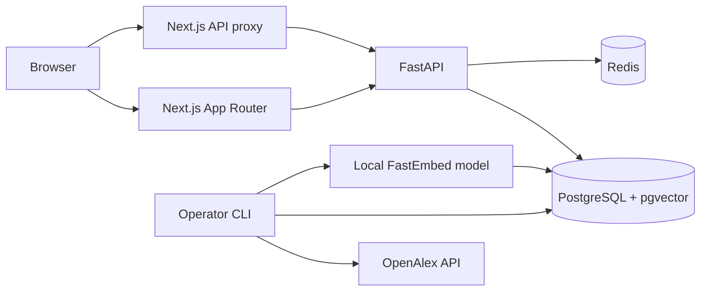
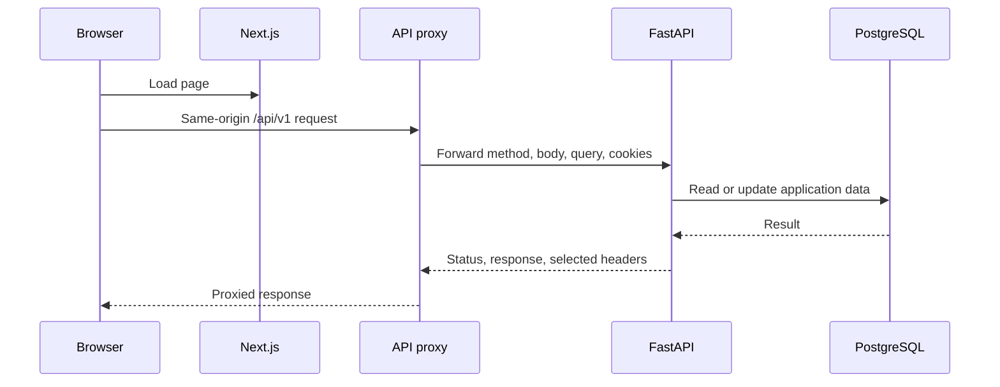
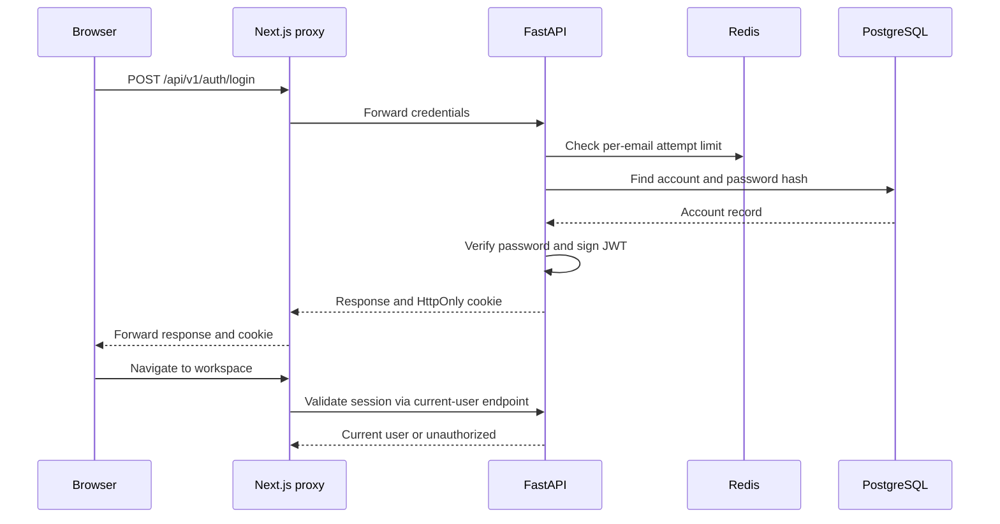
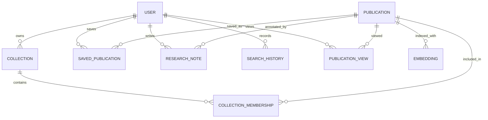
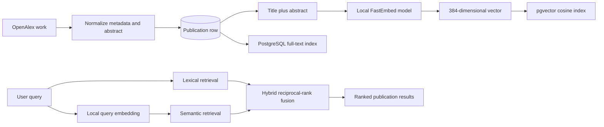

# ScholarSignal

ScholarSignal is a research-paper discovery application. It imports publication
metadata from OpenAlex, indexes titles and abstracts for lexical and semantic
search, and gives registered users a private workspace for saved papers,
collections, notes, recently viewed papers, and search history.

This README describes the implementation in this repository, not a production
deployment. The application is runnable locally with Docker Compose. The
repository does not establish production readiness.

## 1. Project status

At the time of this audit, the local database was documented as containing five
real OpenAlex 2024 publications and five 384-dimensional embeddings. Test
fixtures are separate from those source records. The evaluation data is a
five-query, single-annotator smoke pilot; it is not evidence of general search
quality.

The implementation and its operational safeguards were inspected without
reading private `.env` files or making OpenAlex requests. A defect was found in
the OpenAlex authorization flow: the configured API key is stored but is not
used to form the outgoing authorization value. Live ingestion was therefore
not verified and should be treated as currently unreliable until that code and
its test are corrected. The application can still be run locally against its
existing database.

## 2. Features

- Search publications lexically, semantically, or with hybrid ranking.
- Filter and sort results, and open a publication detail page with source
  metadata.
- Create an account and sign in using a password-backed account.
- Save papers, organize them in collections, and write research notes.
- Review recent paper views and search history.
- Run OpenAlex ingestion and local embedding generation as explicit operator
  commands; neither runs automatically on application startup or user requests.

The small local corpus limits the usefulness of search until more records have
been safely ingested and indexed.

## 3. Technology stack

| Area | Implementation |
|---|---|
| Web application | Next.js 16 App Router, React 19, TypeScript |
| Styling | Tailwind CSS 4 and project CSS |
| API | Python 3.12 project runtime, FastAPI, Pydantic, SQLAlchemy |
| Database | PostgreSQL 17 with pgvector; Alembic migrations |
| Authentication limits | Redis |
| Text embeddings | FastEmbed with `sentence-transformers/all-MiniLM-L6-v2` (384 dimensions) |
| Tests | pytest, Ruff, TypeScript checks, ESLint, Playwright |
| Local orchestration | Docker Compose |
| Publication source | OpenAlex |

Dependency versions are recorded in the Python lock files and frontend lock
file. CI uses Python 3.12 and Node 22.

## 4. Architecture at a glance

The browser talks to the Next.js application. Most browser API requests use a
same-origin Next.js proxy, which forwards to FastAPI. The API reads and writes
PostgreSQL and uses Redis for authentication attempt limits. An operator runs
the ingestion CLI separately; there is no queue or background worker in
Compose.



In the Compose development setup, the browser opens `http://localhost:3000`.
The Next.js container listens on port 3001, mapped to host port 3000. The API
is available at `http://localhost:8000`; PostgreSQL and Redis are also exposed
for local development.

## 5. Browser and API request flow

The catch-all Next.js route forwards the incoming path and query, method,
request body, content type, and cookies to the configured backend URL. It
passes the upstream status and selected response headers back to the browser.
If the backend cannot be reached, the proxy returns a logged JSON 502 rather
than leaving the request without a response.

The workspace page is a server-rendered exception: it forwards the session
cookie to the backend's current-user endpoint and redirects unauthenticated
visitors to the login page.



## 6. Authentication and session flow

Passwords are hashed with `pwdlib`'s recommended password-hash implementation.
Login verifies the stored hash and returns a signed, expiring JWT in an
HttpOnly, SameSite=Lax cookie. The cookie is scoped to `/`; its Secure setting
is configurable for local versus production environments. The frontend shows
submission progress and visible errors. Successful login navigates to the
protected workspace.



## 7. Data model and persistence

The PostgreSQL schema stores normalized publications and source metadata,
model-versioned embeddings, and user-owned workspace records. The workspace
includes collections, saved publications, collection memberships, notes,
search history, and publication views. Foreign keys and owner-scoped API
queries help keep user workspace data isolated.



The application does not implement at-rest encryption itself; that depends on
the database and deployment environment. Search history is capped at 200
entries per user, but no age-based expiry or user-facing history-delete
endpoint was found in the inspected implementation.

## 8. OpenAlex ingestion

Ingestion is an explicit CLI operation, not a startup task or API endpoint. The
`works` path builds filters, requests cursor-paginated Works, normalizes
records, and upserts them by OpenAlex ID. Jobs persist their cursor, page
offset, counters, status, and errors so an interrupted bounded run can resume.
Each page's publication updates and checkpoint are committed together.

The separate smoke path reads at most five results and does not follow the
cursor. It records a checkpoint. The CLI client also queries the OpenAlex rate
limit before Works requests and records usage events. The project budget guard
enforces a maximum of **$0.10 per UTC day**, reserves request cost, and requires
a recent rate-limit snapshot.

The implementation contains a confirmed authorization defect: its auth flow
does not use the configured OpenAlex API key to construct the outgoing
authorization value. In addition, transport exceptions converted to
`OpenAlexError` bypass the raw-transport retry handler; with the budget guard
enabled, 429/5xx responses raise without retrying. Do not rely on live
ingestion until those behaviors are fixed and tested. No external API request
was made during this audit.

## 9. Embeddings and search flow

Publication text is the stripped title and abstract joined by a newline.
FastEmbed runs the configured MiniLM model locally and produces 384-dimensional
vectors. A text hash avoids recomputing unchanged complete embeddings; rows are
identified by publication, model name, and model version. Missing text is
skipped rather than fabricated, and failed generation is recorded.



PostgreSQL lexical search uses English full-text search over title and abstract.
Semantic search embeds the query locally and compares compatible stored
vectors. Hybrid mode combines ranked candidates with reciprocal-rank fusion.
No external model API is used for search or embeddings.

## 10. Search behavior and limitations

Hybrid retrieval caps candidates at up to 1,000 per method and reports when
results are capped. Its returned `total` is the fused candidate count, not an
uncapped count of all matching publications. Because the API allows offsets
beyond that cap, sufficiently deep pages may be empty. Author and topic filters
currently use JSON text substring matching; they are not exact normalized
facets.

SQLite is used by some tests and local fallback paths, but its lexical search
does not reproduce PostgreSQL ranking: it ANDs extracted query terms and
assigns constant lexical scores. PostgreSQL/pgvector is the intended
application database.

## 11. Security and privacy

- Passwords are stored as hashes; login errors use a shared message for unknown
  email and incorrect password.
- JWTs are signed with HS256, have an expiry, and are validated against the
  configured algorithm. The default lifetime is 30 minutes.
- The session cookie is HttpOnly and SameSite=Lax. `Secure` is configurable.
- Redis enforces per-email limits: 10 login attempts per 15 minutes and 5
  registrations per hour. Redis failure is fail-closed for these endpoints.
- Workspace API queries scope data to the authenticated owner. SQL uses
  SQLAlchemy expressions and bound parameters for the raw search query.
- CORS is restricted to one configured origin and a limited method/header set.
- Never commit `.env`, use a production-grade `JWT_SECRET`, or expose database
  credentials. The production configuration rejects the known development
  secret/default cookie mode when `APP_ENV=production`.

Security limitations: rate limiting is per email, not per IP or globally;
logout deletes the browser cookie but does not revoke a copied JWT before
expiry; no explicit CSRF token or Origin validation was found; account
registration distinguishes an already-registered email; and the application
does not establish database at-rest encryption. Production deployment needs a
separate security review and deployment-specific controls.

## 12. Prerequisites

- Docker Engine and Docker Compose v2.
- Git, if cloning the repository.
- For host-only frontend development: Node.js 22 and npm.
- For host-only backend development: Python 3.12 and PostgreSQL/pgvector plus
  Redis, or the corresponding Compose services.

The first Docker build downloads dependencies and the local embedding model
when embedding generation is run. Ensure those downloads are permitted in
your environment.

## 13. Environment configuration

Start from `.env.example`; do not copy private values into documentation,
issues, or source control. The example file is the authoritative list of
supported settings and defaults. Set a strong local PostgreSQL password and a
random `JWT_SECRET` of at least 32 characters.

| Variable | Purpose |
|---|---|
| `POSTGRES_USER`, `POSTGRES_PASSWORD`, `POSTGRES_DB` | Local PostgreSQL role and database used by Compose |
| `DATABASE_URL` | SQLAlchemy database connection |
| `REDIS_URL` | Redis connection for authentication limits |
| `JWT_SECRET` | Signs and verifies session JWTs |
| `APP_ENV` | Selects development, CI, or production configuration checks |
| `CORS_ORIGIN` | The allowed browser origin for direct API access |
| `API_INTERNAL_URL` | Backend URL used by the Next.js server-side proxy |
| `NEXT_ALLOWED_DEV_ORIGINS` | Additional development origins allowed by Next.js HMR |
| `OPENALEX_API_KEY`, `OPENALEX_MAILTO` | Operator ingestion identity; no requests are made automatically |
| `OPENALEX_BASE_URL` | OpenAlex API base URL |

Do not treat values in `.env.example` as production credentials. In Compose,
the frontend proxy should use the service DNS name for the backend; host-run
frontend development normally uses the locally published API port.

## 14. Quick start with Docker Compose

From the repository root:

```bash
cp .env.example .env
# Edit .env and set local-only secrets before starting.
make up
```

Then open:

- Web application: `http://localhost:3000`
- FastAPI interactive documentation: `http://localhost:8000/api/docs`
- FastAPI OpenAPI schema: `http://localhost:8000/openapi.json`

Compose starts PostgreSQL, Redis, FastAPI, and Next.js. The backend container
applies Alembic migrations before starting Uvicorn. Compose runs Next.js in
development mode on container port 3001, mapped to host port 3000, so HMR
remains enabled. Use `localhost` as the browser origin. For a different
development port-forward hostname, configure `NEXT_ALLOWED_DEV_ORIGINS` as a
comma-separated list; do not hardcode a temporary IP address.

The PostgreSQL data is held in a named Compose volume and persists across
container restarts. `docker compose down` stops services without deleting that
volume. Do not use volume-removal flags unless you explicitly intend to erase
local database data.

## 15. Run and inspect services

```bash
docker compose ps
docker compose logs -f backend
docker compose logs -f frontend
```

Stop the running services with `docker compose down`. This does not remove the
named database volume. The frontend Dockerfile's default command is the
production-style `npm run start`; Compose overrides it with `npm run dev` for
local development.

## 16. Run components outside Compose

For frontend-only host development, start the API and its PostgreSQL/Redis
dependencies first, then run:

```bash
cd frontend
npm ci
npm run dev
```

The development server binds to all interfaces on port 3001. Visit
`http://localhost:3001`. Its proxy defaults to a backend at
`http://localhost:8000`; set `API_INTERNAL_URL` if the API is elsewhere.
Do not start a second frontend server on a port already in use.

For a host-run backend, install the development dependencies, configure the
database, Redis, and environment variables, apply migrations, then start:

```bash
python -m pip install -r requirements-dev.txt
alembic upgrade head
uvicorn backend.app.main:app --reload --host 0.0.0.0 --port 8000
```

The Compose setup is the least ambiguous way to run the full stack.

## 17. Database migrations and data safety

Alembic migrations are in `backend/migrations/versions/`; the current schema
head is `0007_research_workspace`. Compose applies migrations when the backend
starts. For an explicit local run:

```bash
docker compose exec backend alembic upgrade head
docker compose exec backend alembic current
```

Migrations update schema; they are not a substitute for backups. The project
does not configure automated database backups. Do not reset the database or
remove the Compose volume as part of normal setup or testing.

## 18. OpenAlex ingestion commands

Ingestion is operator-only and consumes the OpenAlex usage budget. Review the
usage ledger and the current source behavior before running any command. The
authorization and retry defects described above mean live ingestion is not
currently verified.

The CLI has a bounded Works ingestion path, a one-page smoke path, a usage
ledger command, and an embeddings command. Use the module help to confirm
supported options for the checked-out revision:

```bash
docker compose exec backend python -m backend.app.ingestion.cli --help
docker compose exec backend python -m backend.app.ingestion.cli works --help
docker compose exec backend python -m backend.app.ingestion.cli budget
```

Do not run `works` or the smoke command casually: they contact OpenAlex, and a
saved cursor can resume a previous job. The persisted budget is limited to
$0.10 per UTC day. Avoid repeating a command when its previous result is
uncertain; inspect logs and the usage ledger first. Ingestion is never part of
the normal startup or test commands documented here.

## 19. Generate embeddings

Embedding generation uses the local FastEmbed model and database; it does not
call a paid embedding API. It should be run only after source records have
been safely ingested. The supported command and batch-size option are:

```bash
docker compose exec backend python -m backend.app.ingestion.cli embeddings --batch-size 32
```

Generation is keyed by publication text hash and model version. Batches default
to 32 and are constrained to 1–512. Failed rows are recorded; missing text is
skipped rather than replaced with synthetic content.

## 20. API overview

The FastAPI application is rooted at `/api/v1`. Authentication endpoints
include:

- `POST /api/v1/auth/register`
- `POST /api/v1/auth/login`
- `POST /api/v1/auth/logout`
- `GET /api/v1/auth/me`

Search, paper details, and workspace operations are also exposed beneath the
versioned API and proxied through Next.js. Use the generated interactive docs
at `/api/docs` and the implementation reference in [docs/API.md](docs/API.md)
for exact request schemas, response shapes, filters, and route details.

## 21. Tests and quality checks

The backend test suite is under `backend/tests`. CI runs against PostgreSQL 17
and Redis 7.4, applies migrations, and runs pytest, Ruff, Python compilation,
frontend typecheck/lint/build, and Playwright. Local fallback fixtures use
SQLite and fake Redis, so those tests do not alone prove PostgreSQL behavior.

```bash
python -m pip install -r requirements-dev.txt
pytest -q backend/tests
ruff check backend
python -m compileall -q backend

cd frontend
npm ci
npm run typecheck
npm run lint
npm run build
npx playwright test
```

Playwright may require `npx playwright install chromium` on a host. Refer to
[docs/DEPLOYMENT.md](docs/DEPLOYMENT.md) for the Compose-based browser test
setup.

At the latest local verification recorded for this audit: backend tests
reported 42 passed and 1 skipped, Ruff and Python compilation passed, frontend
typecheck/lint/build passed, and all 8 Playwright tests passed. One
Starlette/httpx deprecation warning was emitted. These are local results; they
are not a claim that hosted CI has passed.

## 22. Evaluation

The evaluation code calculates precision, recall, mean reciprocal rank, nDCG,
and latency for lexical, semantic, and hybrid retrieval. Its versioned pilot
contains five queries over five documents and was labeled by one annotator.
Treat it as a pipeline smoke check only: its size and annotation method do not
support broad relevance or comparative-quality claims.

See [docs/EVALUATION.md](docs/EVALUATION.md),
[docs/ML_METHODOLOGY.md](docs/ML_METHODOLOGY.md), and
[docs/EXPERIMENTS.md](docs/EXPERIMENTS.md) for methodology and evidence.
Evaluation is not run by CI as a quality benchmark.

## 23. Repository structure

```text
.
├── backend/
│   ├── app/
│   │   ├── api/             # FastAPI route handlers
│   │   ├── core/            # Settings and shared configuration
│   │   ├── ingestion/       # OpenAlex client, normalization, embeddings, CLI
│   │   ├── models/          # SQLAlchemy models
│   │   ├── schemas/         # Pydantic request/response schemas
│   │   └── services/        # Authentication and search logic
│   ├── migrations/          # Alembic schema history
│   └── tests/               # Backend tests
├── frontend/
│   ├── app/                 # Next.js App Router pages, API proxy, UI
│   └── e2e/                 # Playwright browser tests
├── docs/                    # Architecture, API, operations, evaluation
├── evaluation/              # Small versioned relevance pilot
├── docker-compose.yml
├── Makefile
├── pyproject.toml
└── README.md
```

## 24. Troubleshooting

| Symptom | Check |
|---|---|
| Web page does not load | `docker compose ps`, frontend logs, and host port 3000 availability |
| HMR WebSocket fails | Open the site through `localhost:3000`; check `NEXT_ALLOWED_DEV_ORIGINS` when using a port-forward hostname; confirm Compose is running `npm run dev` on container port 3001 |
| API proxy returns 502 | Check backend health/logs and the frontend's `API_INTERNAL_URL`; in Compose it must resolve to the backend service |
| Login is unavailable | Check backend and Redis health, `APP_ENV`, and the configured JWT secret; Redis-backed limits fail closed if Redis is unavailable |
| Database connection fails | Check PostgreSQL health, Compose environment values, and `docker compose logs backend` |
| Search returns few/no results | The local corpus is small; confirm records and compatible embedding rows exist before inferring a search defect |
| OpenAlex ingestion fails | Do not blindly retry; inspect logs and usage records. The current authorization and retry limitations are documented above |
| Browser tests fail to launch | Install Playwright Chromium or use the Compose test setup in `docs/DEPLOYMENT.md` |

## 25. Known gaps and recommended next work

Priority follow-up work identified by source inspection:

1. Correct OpenAlex authorization to use the configured key safely, update the
   corresponding test, and add an offline test that verifies the key is passed
   without logging it. Then test retry handling for transport, 429, and 5xx
   cases without making live API requests.
2. Expand authentication throttling beyond email identity, and assess explicit
   CSRF/origin protections and token revocation needs for the intended
   deployment.
3. Improve hybrid pagination/count semantics and replace JSON text substring
   filters with normalized searchable fields if corpus scale warrants it.
4. Grow the relevance dataset with independent annotators and representative
   queries before making retrieval-quality claims.
5. Add operational backups, deployment hardening, and load testing before
   considering production use.

The repository does not currently provide a production deployment, external
queue/background worker, automated backup process, load-test results, or a
representative retrieval benchmark.

## 26. Contributing, license, and further reading

Keep changes focused, add or update tests, and run the relevant checks from
section 21 before opening a change for review. Avoid including private
environment files, database snapshots, account data, or API credentials.

No `LICENSE` file was present during this audit. Do not assume the project is
open-source or freely reusable until its owner adds and chooses an appropriate
license.

Further technical documentation:

- [Architecture](docs/ARCHITECTURE.md)
- [API reference](docs/API.md)
- [Data pipeline](docs/DATA_PIPELINE.md)
- [Deployment and local testing](docs/DEPLOYMENT.md)
- [Limitations](docs/LIMITATIONS.md)
- [Evaluation](docs/EVALUATION.md)
- [ML methodology](docs/ML_METHODOLOGY.md)
- [Experiments](docs/EXPERIMENTS.md)
- [Milestone checklist and historical evidence](docs/MILESTONE_CHECKLIST.md)
